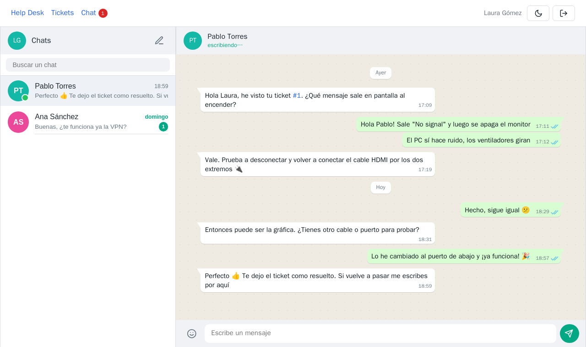
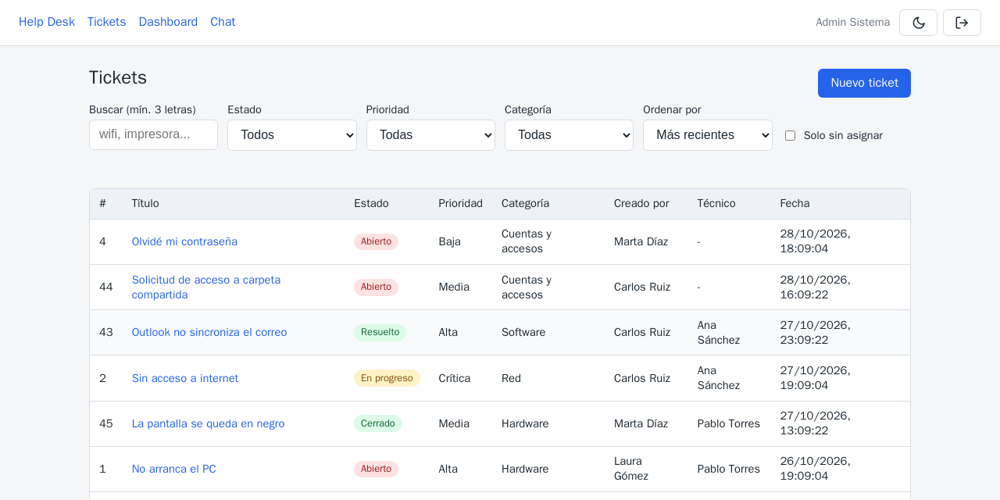
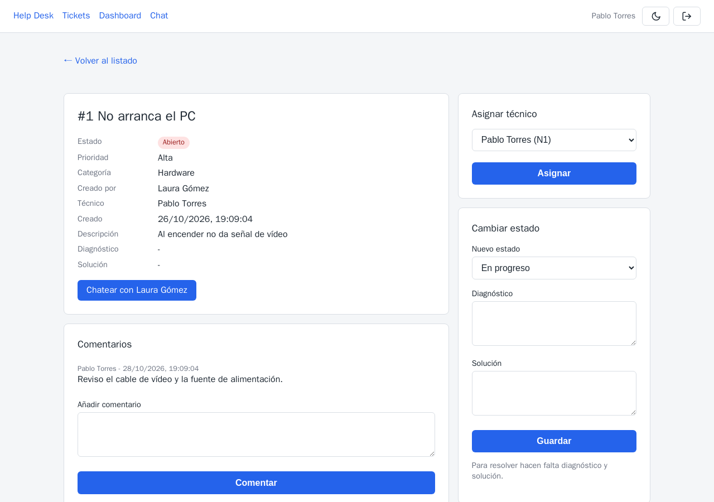
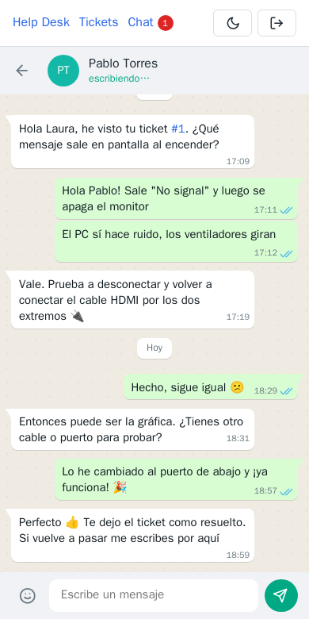
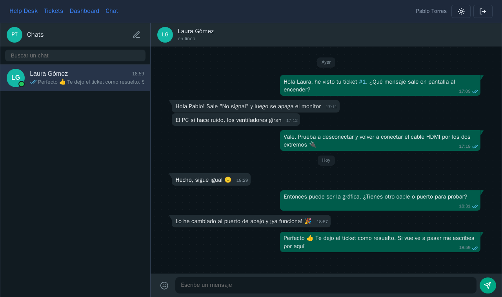
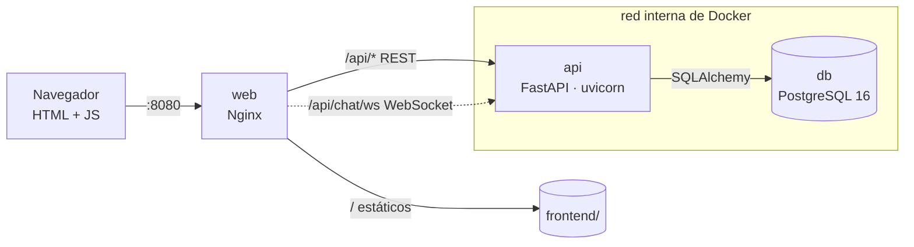
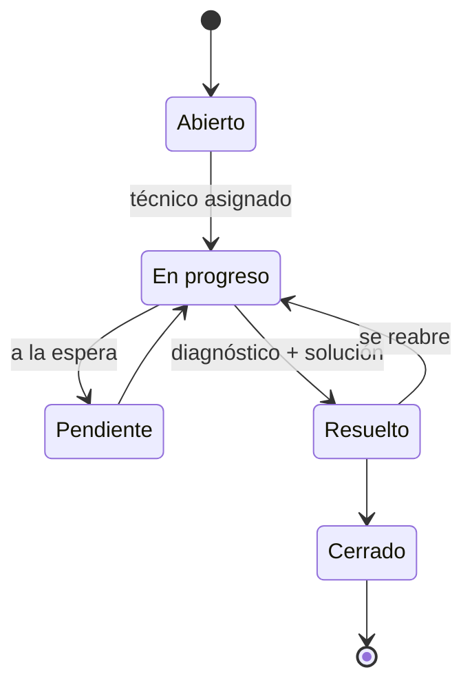
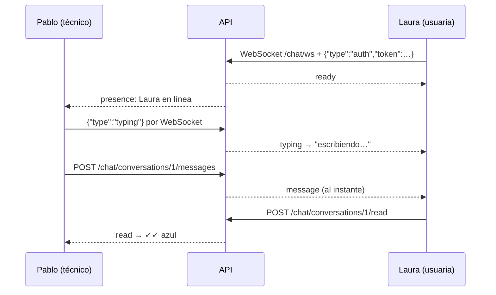
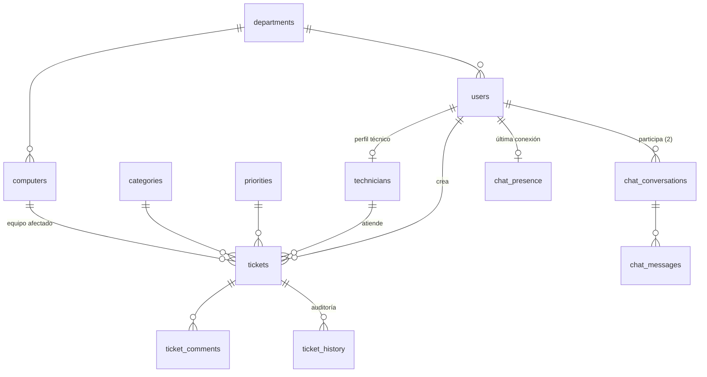

# Help Desk Ticketing System

[](https://github.com/Alberto-AS1026/helpdesk-ticketing-system/actions/workflows/tests.yml)


Sistema de **gestión de incidencias de soporte técnico** (help desk) para una
empresa: los empleados abren tickets, los técnicos los asignan, diagnostican y
resuelven, y el administrador lo supervisa todo desde un dashboard.

Incluye un **chat en tiempo real** entre usuarios y técnicos para intentar
resolver el problema **en remoto antes de desplazarse** al puesto.



---

## Índice

- [Funcionalidades](#funcionalidades)
- [Capturas](#capturas)
- [Puesta en marcha rápida](#puesta-en-marcha-rápida)
- [Prueba guiada en 5 minutos](#prueba-guiada-en-5-minutos)
- [Arquitectura](#arquitectura)
- [Ciclo de vida de un ticket](#ciclo-de-vida-de-un-ticket)
- [Roles y permisos](#roles-y-permisos)
- [Chat en tiempo real](#chat-en-tiempo-real)
- [API](#api)
- [Modelo de datos](#modelo-de-datos)
- [Configuración](#configuración)
- [Tests e integración continua](#tests-e-integración-continua)
- [Estructura del proyecto](#estructura-del-proyecto)
- [Seguridad](#seguridad)
- [Limitaciones conocidas](#limitaciones-conocidas)
- [Documentación adicional](#documentación-adicional)

---

## Funcionalidades

**Tickets**
- Alta de incidencias con prioridad (Baja → Crítica), categoría y equipo afectado.
- Flujo de estados con reglas de negocio: no se trabaja un ticket sin técnico
  asignado ni se resuelve sin **diagnóstico y solución**.
- Cálculo automático del **tiempo de resolución**.
- Comentarios e **historial de auditoría** de cada cambio (quién, qué y cuándo).
- Búsqueda de texto, filtros (estado, prioridad, categoría, técnico, fechas,
  sin asignar), ordenación y paginación. Rápida incluso con 50 000 tickets
  gracias a índices `pg_trgm`.

**Dashboard** (técnicos y administradores)
- KPIs: total, activos, sin asignar, resueltos y tiempo medio de resolución.
- Gráficos por estado, prioridad, categoría, carga por técnico y tickets por día.

**Chat**
- Conversaciones 1 a 1 con aspecto de app de mensajería: checks de
  enviado/entregado/leído, "en línea", "escribiendo…", emojis y enlaces
  automáticos a tickets (`#12`).
- Mensajes **al instante por WebSocket**, con vuelta automática a polling si
  la conexión no está disponible.
- Botón **"Chatear con…"** en cada ticket y contador de no leídos en la barra.

**Interfaz**
- Modo **claro y oscuro**, que se recuerda y sigue al sistema la primera vez.
- Estados con código de color: 🔴 abierto · 🟡 en progreso / pendiente ·
  🟢 resuelto / cerrado.
- Adaptada a móvil. HTML, CSS y JavaScript **sin frameworks** ni CDNs.

---

## Capturas

| Listado de tickets | Detalle (vista del técnico) |
|---|---|
|  |  |

| Dashboard (modo oscuro) | Chat en el móvil |
|---|---|
|  |  |

<details>
<summary>Chat en modo oscuro</summary>



</details>

---

## Puesta en marcha rápida

Solo necesitas **Docker** y **Docker Compose v2**.

```bash
git clone https://github.com/Alberto-AS1026/helpdesk-ticketing-system.git
cd helpdesk-ticketing-system

cp .env.example .env
# Edita .env y pon una DB_PASSWORD propia y una SECRET_KEY nueva:
openssl rand -hex 32

docker compose up -d --build
docker compose ps        # db y api deben salir "healthy"
```

Abre **<http://localhost:8080>**.

La primera vez, PostgreSQL crea el esquema y carga datos de ejemplo
automáticamente. Para empezar de cero: `docker compose down -v && docker compose up -d`.

### Usuarios de prueba

Contraseña para todos: **`Helpdesk_2026`** (solo para desarrollo).

| Email | Rol | Qué puede hacer |
|---|---|---|
| `admin@empresa.test` | Administrador | Todo, incluida la gestión de usuarios y catálogos |
| `pablo@empresa.test` · `ana@empresa.test` | Técnico | Asignar, diagnosticar y resolver; ver el dashboard |
| `laura@empresa.test` · `carlos@empresa.test` · `marta@empresa.test` | Usuario | Abrir tickets, ver y comentar los suyos, chatear con técnicos |

<details>
<summary>Datos de volumen para pruebas de rendimiento (opcional)</summary>

```bash
docker compose exec -T db psql -U helpdesk_user -d helpdesk < database/03_bulk_test_data.sql
```

Genera 50 000 tickets `BULK-` para probar búsquedas y dashboard con volumen.

</details>

---

## Prueba guiada en 5 minutos

Abre dos ventanas: una normal y otra de incógnito (cada pestaña tiene su
propia sesión).

1. **Laura** (`laura@empresa.test`) pulsa **Nuevo ticket** y describe un
   problema. Solo ve sus propios tickets.
2. **Pablo** (`pablo@empresa.test`) abre el ticket, se lo **asigna** y lo
   pasa a **En progreso**.
3. Pablo pulsa **Chatear con Laura Gómez**: se abre el chat con
   *"Sobre el ticket #N: "* ya escrito. Laura ve el mensaje al instante, el
   contador rojo de **Chat** y a Pablo **"escribiendo…"**.
4. Resuelto en remoto: Pablo registra **diagnóstico y solución** y pasa el
   ticket a **Resuelto**. El historial lo deja todo registrado.
5. Entra como **admin** y abre el **Dashboard**. Prueba el modo oscuro con el
   botón de la luna.

---

## Arquitectura



| Servicio | Imagen | Función |
|---|---|---|
| `web` | `nginx:1.27-alpine` | Sirve el frontend, hace de proxy de `/api` (REST y WebSocket) y añade las cabeceras de seguridad y la CSP. **Único puerto publicado.** |
| `api` | `backend/Dockerfile` | FastAPI con usuario sin privilegios. Solo confía en `X-Forwarded-For` si viene de Nginx. |
| `db` | `postgres:16` | Datos en el volumen `pgdata`. Sin puerto publicado. |

| Capa | Tecnología |
|---|---|
| Backend | FastAPI, SQLAlchemy 2, Pydantic 2, PyJWT, bcrypt |
| Base de datos | PostgreSQL 16 con `pg_trgm` y `pgcrypto` |
| Frontend | HTML, CSS y JavaScript nativos; Chart.js servido en local |
| Infraestructura | Docker Compose, Nginx |
| Calidad | pytest, pytest-cov, GitHub Actions |

---

## Ciclo de vida de un ticket



Las reglas se validan en la API (`409` si la transición no está permitida y
`422` si faltan diagnóstico o solución). Cada cambio queda en `ticket_history`
en la misma transacción.

---

## Roles y permisos

| Recurso | Usuario | Técnico | Administrador |
|---|---|---|---|
| Tickets | Crear; ver y comentar **solo los suyos** | Ver todos, asignar, cambiar estado y resolver | Igual que el técnico |
| Dashboard y estadísticas | — | ✅ | ✅ |
| Usuarios y técnicos | — | Ver | Gestionar |
| Departamentos, categorías y prioridades | Ver | Ver | Gestionar |
| Equipos | Ver | Gestionar | Gestionar |
| Chat | Solo con técnicos y administradores | Con cualquiera | Con cualquiera |

- Un usuario que pide un ticket ajeno recibe `404`, no `403`, para no
  confirmar que existe. Lo mismo con las conversaciones de chat ajenas, que
  ni siquiera el administrador puede leer.
- La identidad (creador, autor, responsable del cambio) se toma **siempre
  del token**, nunca del cuerpo de la petición.
- La política está centralizada en [`backend/app/main.py`](backend/app/main.py).

---

## Chat en tiempo real



- **Escribir y leer van por REST**, con sus permisos y validaciones. El
  WebSocket solo **avisa** de mensajes nuevos, lecturas, "escribiendo…" y
  conexiones.
- El token se envía en el **primer mensaje**, nunca en la URL, para que no
  quede en los logs. Si no es válido o caduca, el servidor cierra con `4401`.
- Si el WebSocket cae, el navegador se reconecta con espera creciente y
  mientras tanto consulta por polling cada 2,5 s. Al reconectar recupera lo
  pendiente con `/sync?after_id=`.

---

## API

Todas las rutas van detrás de Nginx con el prefijo `/api`, por ejemplo
`POST /api/auth/login`. Autenticación con `Authorization: Bearer <JWT>`.

| Recurso | Endpoints |
|---|---|
| Autenticación | `POST /auth/login` · `GET /auth/me` |
| Tickets | `GET /tickets` (búsqueda, filtros y paginación) · `POST /tickets` · `GET /tickets/{id}` |
| Flujo del ticket | `PATCH /tickets/{id}/assign` · `PATCH /tickets/{id}/status` · `PATCH /tickets/{id}/resolution` |
| Comentarios e historial | `GET`/`POST /tickets/{id}/comments` · `GET /tickets/{id}/history` |
| Estadísticas | `GET /stats?days=30` |
| Chat | `GET /chat/contacts` · `GET`/`POST /chat/conversations` · `GET /chat/unread` |
| Mensajes | `GET /chat/conversations/{id}/messages` · `GET …/sync` · `POST …/messages` · `POST …/read` · `POST …/typing` |
| Tiempo real | `WS /chat/ws` |
| Catálogos (CRUD) | `/departments` · `/categories` · `/priorities` · `/computers` · `/users` · `/technicians` |
| Salud | `GET /health` · `GET /health/db` |

Ejemplo:

```bash
TOKEN=$(curl -s -X POST localhost:8080/api/auth/login \
  -d 'username=pablo@empresa.test&password=Helpdesk_2026' | jq -r .access_token)

curl -s "localhost:8080/api/tickets?status=Abierto&sort=priority" \
  -H "Authorization: Bearer $TOKEN" | jq '.items[] | {id, title, priority_name}'
```

---

## Modelo de datos



Los scripts están en [`database/`](database) y se ejecutan en orden:

| Script | Contenido |
|---|---|
| `01_schema.sql` | Tablas, claves foráneas y `CHECK` (estados, roles, niveles) |
| `02_seed.sql` | Datos de ejemplo: departamentos, usuarios, equipos y tickets |
| `03_bulk_test_data.sql` | Opcional: 50 000 tickets para pruebas de rendimiento |
| `04_indexes.sql` | Índices compuestos y de trigramas (`pg_trgm`) |
| `05_dev_passwords.sql` | Contraseña de laboratorio para los usuarios del seed |
| `06_chat.sql` | Tablas del chat. Se puede reaplicar sobre una base existente |

---

## Configuración

Variables del archivo `.env` (plantilla en [`.env.example`](.env.example)):

| Variable | Obligatoria | Descripción |
|---|---|---|
| `DB_PASSWORD` | ✅ | Contraseña de PostgreSQL |
| `SECRET_KEY` | ✅ | Clave para firmar los JWT (mínimo 32 caracteres; `openssl rand -hex 32`) |
| `ACCESS_TOKEN_EXPIRE_MINUTES` | | Duración de la sesión (por defecto 60) |
| `CORS_ORIGINS` | | Orígenes permitidos, separados por comas |
| `WEB_PORT` | | Puerto del host para la web (por defecto 8080) |
| `LOGIN_MAX_ATTEMPTS` · `LOGIN_WINDOW_SECONDS` | | Límite de intentos de login (por defecto 5 en 15 min) |

`docker compose` no arranca si faltan `DB_PASSWORD` o `SECRET_KEY`.

<details>
<summary>Comandos útiles</summary>

```bash
docker compose logs -f api                         # logs de la API
docker compose exec api tail -f logs/helpdesk.log  # eventos de seguridad
docker compose exec db psql -U helpdesk_user -d helpdesk
curl localhost:8080/api/health/db

# Aplicar las tablas del chat a una base creada antes de añadirlo
docker compose exec -T db psql -U helpdesk_user -d helpdesk < database/06_chat.sql
```

</details>

---

## Tests e integración continua

**130 tests** con pytest y un **92 % de cobertura**. Cubren autenticación,
flujo y reglas de tickets, visibilidad por rol, historial, la matriz completa
de permisos, búsqueda, estadísticas, chat y WebSocket.

GitHub Actions los ejecuta en cada push y pull request a `main`
([`.github/workflows/tests.yml`](.github/workflows/tests.yml)), con
PostgreSQL como *service container*.

Para ejecutarlos en local con la pila de Docker en marcha:

```bash
docker compose exec db createdb -U helpdesk_user helpdesk_test
for f in 01_schema 04_indexes 06_chat; do
  docker compose exec -T db psql -U helpdesk_user -d helpdesk_test < database/$f.sql
done

docker run --rm --network helpdesk-ticketing-system_backend \
  -v "$PWD/backend:/src:ro" \
  -e TEST_DATABASE_URL=postgresql://helpdesk_user:<DB_PASSWORD>@db:5432/helpdesk_test \
  -e SECRET_KEY=clave-solo-para-tests-0123456789abcdef0123456789 \
  python:3.13-slim sh -c "cp -r /src /srv/b && cd /srv/b \
    && pip install -q -r requirements-dev.txt \
    && python -m pytest --cov=app -q -p no:cacheprovider"
```

> El `conftest.py` se niega a arrancar si la base no termina en `_test`,
> porque los tests vacían las tablas antes de cada caso.

---

## Estructura del proyecto

```
.
├── backend/
│   ├── app/
│   │   ├── main.py            # App FastAPI y política de permisos por router
│   │   ├── routers/           # auth, tickets, chat, stats y CRUD de catálogos
│   │   ├── models.py          # Modelos SQLAlchemy
│   │   ├── schemas.py         # Validación con Pydantic
│   │   ├── realtime.py        # Registro de WebSockets y envío de avisos
│   │   ├── security.py        # bcrypt y JWT
│   │   ├── dependencies.py    # Usuario actual y control de roles
│   │   └── ratelimit.py       # Límite de intentos de login
│   ├── tests/                 # pytest
│   ├── scripts/               # Utilidades de desarrollo
│   └── Dockerfile
├── frontend/                  # Páginas HTML, css/ y js/ (sin frameworks)
├── database/                  # Scripts SQL (ver "Modelo de datos")
├── nginx/
│   ├── helpdesk.docker.conf   # Para docker compose
│   └── helpdesk.conf          # Para una instalación directa en un servidor
├── docs/
│   ├── TROUBLESHOOTING.md     # Problemas reales y cómo se resolvieron
│   └── img/                   # Capturas del README
├── docker-compose.yml
├── SECURITY.md
└── CHANGELOG.md
```

---

## Seguridad

Resumen; el detalle está en [SECURITY.md](SECURITY.md).

- **Contraseñas** con bcrypt; **JWT** firmado con caducidad. El rol y el
  estado del usuario se leen de la base de datos en cada petición.
- **Límite de login**: 5 intentos fallidos en 15 minutos por IP y email. La
  IP real del cliente llega desde Nginx y no se puede falsear.
- **Inyección SQL**: todo el acceso a datos va parametrizado con SQLAlchemy.
- **XSS**: todo se pinta con `textContent`, nunca con `innerHTML`. CSP
  estricta sin `unsafe-inline`.
- **Red**: solo Nginx expone un puerto; la API y PostgreSQL quedan en la red
  interna de Docker.
- **Cabeceras**: `Content-Security-Policy`, `X-Frame-Options`,
  `X-Content-Type-Options`, `Referrer-Policy` y `Cache-Control`.

---

## Limitaciones conocidas

Es un proyecto de **portfolio y laboratorio**. Antes de exponerlo a Internet
harían falta, entre otras cosas:

- **HTTPS** (TLS) en Nginx.
- **Contraseñas reales**: las de los usuarios de prueba son públicas, y falta
  un flujo para cambiarlas o recuperarlas.
- **Límite de login persistente**: ahora está en memoria; haría falta Redis o Nginx.
- **Varias réplicas de la API**: el WebSocket requiere un solo proceso, porque
  las conexiones se registran en memoria. Para escalar, repartir los avisos
  con `LISTEN/NOTIFY` de PostgreSQL.
- **Revocación de tokens** y *refresh tokens*.

---

## Documentación adicional

- [SECURITY.md](SECURITY.md): medidas de seguridad, matriz de permisos y limitaciones.
- [CHANGELOG.md](CHANGELOG.md): historial de versiones.
- [docs/TROUBLESHOOTING.md](docs/TROUBLESHOOTING.md): 33 problemas reales del
  desarrollo, cada uno con síntoma, hipótesis, comprobaciones, diagnóstico,
  solución y prevención.
