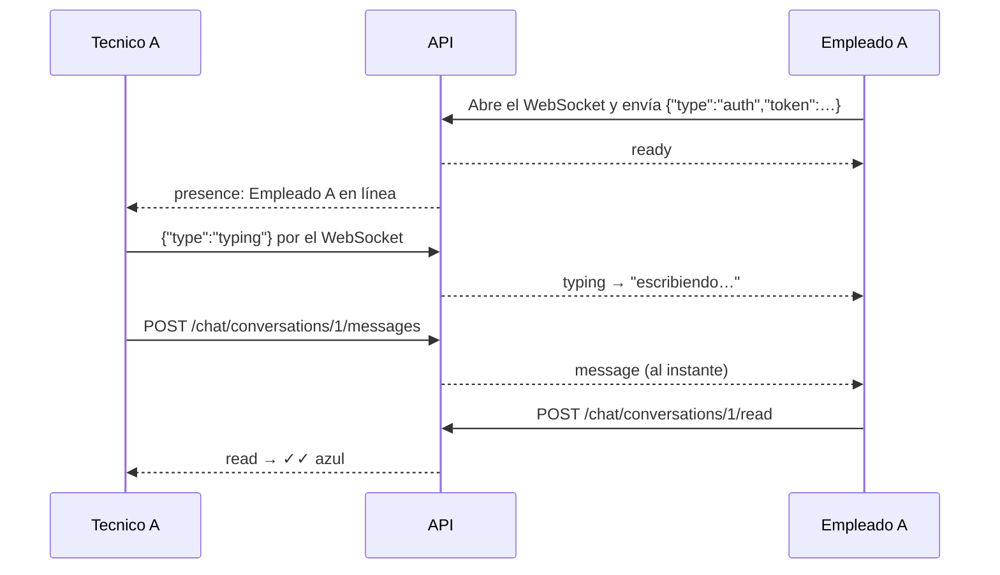

# Backend (API)

La API es el cerebro de la aplicación. Recibe las peticiones de la interfaz,
decide si quien las hace tiene permiso, aplica las reglas de los incidentes,
guarda los cambios en PostgreSQL y avisa en tiempo real a quien tenga que
enterarse. Está escrita en Python con **FastAPI**.

## Cómo está organizada

```
backend/
├── app/
│   ├── main.py            # Crea la aplicación y define quién puede usar cada parte
│   ├── routers/           # Un archivo por recurso: auth, tickets, chat, stats y catálogos
│   ├── models.py          # Las tablas de la base de datos vistas desde Python (SQLAlchemy)
│   ├── schemas.py         # Qué datos se aceptan y se devuelven, y cómo se validan (Pydantic)
│   ├── dependencies.py    # Saber quién es el usuario y comprobar su rol
│   ├── security.py        # Cifrado de contraseñas (bcrypt) y tokens de sesión (JWT)
│   ├── realtime.py        # Conexiones abiertas del chat y envío de avisos
│   ├── ratelimit.py       # Límite de intentos de login
│   ├── config.py          # Lectura de la configuración del .env
│   └── database.py        # Conexión con PostgreSQL
├── tests/                 # Tests automáticos con pytest
├── scripts/               # Utilidades de desarrollo
└── Dockerfile
```

## Permisos: un único sitio para revisarlos

Todos los permisos generales están juntos en [`app/main.py`](app/main.py).
Cada grupo de rutas se registra indicando qué roles pueden **leer** y qué
roles pueden **escribir**. Por ejemplo, las categorías las puede leer
cualquiera pero solo las modifica el administrador:

```python
app.include_router(
    categories.router, dependencies=[Depends(protect(read=ALL_ROLES, write=ADMIN_ONLY))]
)
```

Así, para saber quién puede hacer qué basta con leer un archivo. Las reglas
más finas (por ejemplo, que solo el personal técnico pueda resolver) se
comprueban dentro de cada ruta.

Hay tres principios que se respetan en todo el código:

- **La identidad sale siempre del token**, nunca de lo que envía el
  navegador. Nadie puede crear un incidente "en nombre de" otra persona.
- **Lo ajeno no existe**: si un empleado pide un incidente o una conversación
  que no es suya, recibe un `404` (no encontrado) en lugar de un `403` (sin
  permiso), para no confirmar que existe.
- **El filtro por rol va primero**: en los listados, la restricción "solo los
  tuyos" se aplica antes que cualquier otro filtro, así que ninguna búsqueda
  puede saltársela.

## Las reglas de los incidentes

Las transiciones permitidas entre estados están definidas en
[`app/routers/tickets.py`](app/routers/tickets.py) y la API se niega a hacer
cualquier otra:

- Si se pide un cambio de estado no permitido, responde `409` (conflicto).
- No se puede pasar a *En progreso* sin un técnico asignado.
- No se puede pasar a *Resuelto* sin diagnóstico y solución (`422`).
- Al resolver, calcula automáticamente el tiempo de resolución; si se
  reabre, lo borra.
- Cada cambio se apunta en el historial (`ticket_history`) **en la misma
  transacción** que el cambio en sí: o se guardan los dos o ninguno.

## El chat por dentro

El chat combina dos mecanismos:

- **Enviar y leer mensajes se hace con peticiones normales (REST)**, que
  pasan por los mismos permisos y validaciones que el resto de la API.
- **Un WebSocket solo sirve para avisar.** Un WebSocket es una conexión que se
  queda abierta entre el navegador y el servidor, de modo que el servidor
  puede enviar cosas sin que se las pidan. Se usa para avisar al instante de
  mensajes nuevos, lecturas, "escribiendo…" y quién está conectado.



Algunos detalles importantes:

- El token se envía en el **primer mensaje** del WebSocket y nunca en la
  dirección, para que no acabe guardado en ningún log. Si no es válido o
  caduca, el servidor cierra la conexión con el código `4401`.
- Si la conexión se cae, el navegador se reconecta solo, esperando cada vez
  un poco más, y mientras tanto consulta los mensajes cada 2,5 segundos. Al
  volver, recupera lo que se haya perdido con `/sync?after_id=`.
- Las conexiones abiertas se guardan en la memoria del proceso
  ([`app/realtime.py`](app/realtime.py)). Por eso la API se ejecuta con **un
  único proceso** de uvicorn: con varios, cada uno solo conocería sus propias
  conexiones.

## Rutas de la API

Detrás de Nginx todas las rutas llevan el prefijo `/api` (por ejemplo,
`POST /api/auth/login`). Salvo el login, todas piden la cabecera
`Authorization: Bearer <token>`.

| Para qué | Rutas |
|---|---|
| Iniciar sesión y saber quién soy | `POST /auth/login` · `GET /auth/me` |
| Incidentes | `GET /tickets` (búsqueda, filtros y paginación) · `POST /tickets` · `GET /tickets/{id}` |
| Trabajar un incidente | `PATCH /tickets/{id}/assign` · `PATCH /tickets/{id}/status` · `PATCH /tickets/{id}/resolution` |
| Comentarios e historial | `GET`/`POST /tickets/{id}/comments` · `GET /tickets/{id}/history` |
| Estadísticas del dashboard | `GET /stats?days=30` |
| Chat | `GET /chat/contacts` · `GET`/`POST /chat/conversations` · `GET /chat/unread` |
| Mensajes | `GET /chat/conversations/{id}/messages` · `GET …/sync` · `POST …/messages` · `POST …/read` · `POST …/typing` |
| Tiempo real | `WS /chat/ws` |
| Catálogos | `/departments` · `/categories` · `/priorities` · `/computers` · `/users` · `/technicians` |
| Comprobar que todo funciona | `GET /health` · `GET /health/db` |

Un ejemplo desde la terminal: iniciar sesión como técnico y listar los
incidentes abiertos, ordenados por prioridad.

```bash
TOKEN=$(curl -s -X POST localhost:8080/api/auth/login \
  -d 'username=tecnicoA@empresa.test&password=TecnicoAHelp2026' | jq -r .access_token)

curl -s "localhost:8080/api/tickets?status=Abierto&sort=priority" \
  -H "Authorization: Bearer $TOKEN" | jq '.items[] | {id, title, priority_name}'
```

## Tests

Hay **130 tests** con pytest y cubren el **92 %** del código: inicio de
sesión, reglas de los incidentes, qué ve cada rol, el historial, la matriz
completa de permisos, la búsqueda, las estadísticas, el chat y el WebSocket.
GitHub Actions los ejecuta en cada push y pull request a `main`
([`.github/workflows/tests.yml`](../.github/workflows/tests.yml)).

Los tests usan una base de datos PostgreSQL real, no una simulada, porque
algunas cosas (como la búsqueda con `pg_trgm`) solo se pueden probar de
verdad así. Antes de cada test **se vacían todas las tablas**, así que, por
seguridad, `tests/conftest.py` se niega a arrancar si el nombre de la base
no termina en `_test`.

Para ejecutarlos con la pila de Docker en marcha (desde la raíz del
proyecto):

```bash
# 1. Crear la base de pruebas y cargarle el esquema
docker compose exec db createdb -U helpdesk_user helpdesk_test
for f in 01_schema 04_indexes 06_chat; do
  docker compose exec -T db psql -U helpdesk_user -d helpdesk_test < database/$f.sql
done

# 2. Ejecutar los tests en un contenedor conectado a la misma red
docker run --rm --network helpdesk-ticketing-system_backend \
  -v "$PWD/backend:/src:ro" \
  -e TEST_DATABASE_URL=postgresql://helpdesk_user:<DB_PASSWORD>@db:5432/helpdesk_test \
  -e SECRET_KEY=clave-solo-para-tests-0123456789abcdef0123456789 \
  python:3.13-slim sh -c "cp -r /src /srv/b && cd /srv/b \
    && pip install -q -r requirements-dev.txt \
    && python -m pytest --cov=app -q -p no:cacheprovider"
```

Si tienes PostgreSQL accesible desde tu ordenador, basta con poner
`TEST_DATABASE_URL` y `SECRET_KEY` en el `.env` de la raíz y, desde
`backend/`:

```bash
pip install -r requirements-dev.txt
python -m pytest --cov=app -q                    # todos
python -m pytest tests/test_tickets_rules.py -q  # un solo archivo
```
