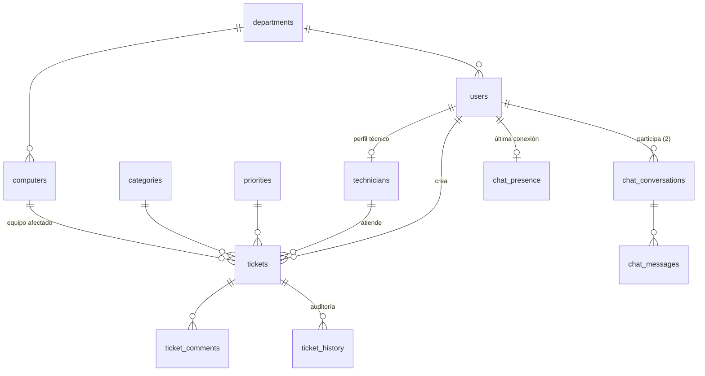

# Base de datos

Los datos se guardan en **PostgreSQL 16**. En esta carpeta están los scripts
SQL que crean las tablas y las rellenan con datos de ejemplo.

## Qué se guarda



En palabras:

- Cada **usuario** pertenece a un **departamento** y tiene un rol: empleado,
  técnico o administrador. Los técnicos tienen además un **perfil de técnico**
  con su especialidad y su nivel (N1, N2 o N3).
- Los **equipos** (ordenadores) pertenecen a un departamento y pueden estar
  asignados a una persona.
- Un **ticket** (incidente) lo crea un usuario, puede estar asignado a un
  técnico, tiene una prioridad y una categoría, y puede indicar qué equipo
  está afectado.
- Cada ticket tiene sus **comentarios** y su **historial**: una entrada por
  cada cambio, con quién lo hizo, qué valor había antes y cuál después.
- El chat guarda **conversaciones** entre dos personas, sus **mensajes** y la
  **última conexión** de cada usuario.

Muchas reglas están protegidas también en la propia base de datos, no solo en
la API: por ejemplo, un ticket solo puede estar en uno de los cinco estados
válidos y un usuario solo puede tener uno de los tres roles.

## Los scripts

Docker ejecuta los scripts en orden alfabético, **solo la primera vez**, es
decir, cuando el volumen de datos está vacío.

| Script | Qué hace |
|---|---|
| `01_schema.sql` | Crea las tablas, las relaciones entre ellas y las restricciones |
| `02_seed.sql` | Datos de ejemplo: departamentos, categorías, prioridades, los 5 usuarios, equipos y algunos incidentes |
| `03_bulk_test_data.sql` | Opcional y manual: 50 000 incidentes para probar el rendimiento |
| `04_indexes.sql` | Índices para que búsquedas y filtros sean rápidos |
| `05_dev_passwords.sql` | Pone las contraseñas de prueba de los usuarios del seed |
| `06_chat.sql` | Crea las tablas del chat. Se puede volver a ejecutar sin romper nada |

La contraseña de cada usuario de ejemplo es su nombre sin espacios seguido de
`Help2026` (por ejemplo, `TecnicoAHelp2026`). Si alguna vez necesitas volver a
ponerlas sobre una base ya creada:

```bash
docker compose exec -T db psql -U helpdesk_user -d helpdesk < database/05_dev_passwords.sql
```

## Búsquedas rápidas con muchos datos

La búsqueda de texto usa la extensión `pg_trgm`, que divide los textos en
trozos de tres letras para poder buscar palabras sueltas sin recorrer la
tabla entera. Junto con los índices de `04_indexes.sql`, las búsquedas y el
dashboard siguen siendo rápidos con decenas de miles de incidentes. Para
comprobarlo:

```bash
docker compose exec -T db psql -U helpdesk_user -d helpdesk < database/03_bulk_test_data.sql
```

Esto añade 50 000 incidentes cuyo título empieza por `BULK-`.

## Tareas habituales

```bash
# Abrir una consola SQL
docker compose exec db psql -U helpdesk_user -d helpdesk

# Empezar de cero (¡borra todos los datos!) y volver a cargar los scripts
docker compose down -v && docker compose up -d

# Añadir las tablas del chat a una base creada antes de que existiera el chat
docker compose exec -T db psql -U helpdesk_user -d helpdesk < database/06_chat.sql
```

## Si cambias el esquema

No hay herramienta de migraciones: el esquema real está en estos archivos SQL
y `backend/app/models.py` lo refleja a mano. Si añades o cambias una tabla,
hay que tocar los dos sitios, y si es una tabla nueva, añadirla también a la
lista que vacían los tests en `backend/tests/conftest.py`.
