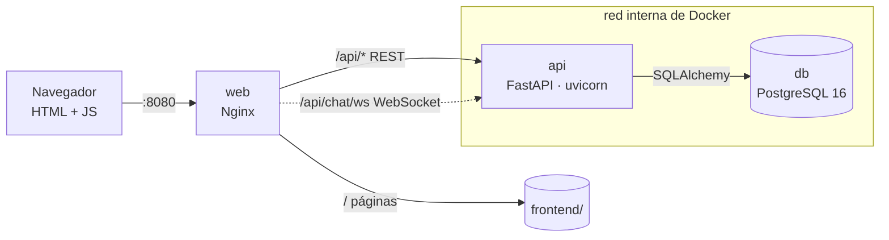

# Arquitectura

Este documento explica cómo está montada la aplicación por dentro: qué piezas
la forman, cómo se comunican, cómo se protege y qué le faltaría para usarse
en un entorno real.

## Las piezas

La aplicación se compone de tres contenedores de Docker que arrancan juntos
con `docker compose`:



- **`web` (Nginx)** es la única puerta de entrada. Sirve las páginas de la
  interfaz y reenvía a la API todo lo que empieza por `/api`, incluida la
  conexión en tiempo real del chat. También añade las cabeceras de seguridad.
  Es el único contenedor con un puerto abierto al exterior (el 8080).
- **`api` (FastAPI)** contiene toda la lógica: quién puede hacer qué, las
  reglas de los incidentes, el chat… Se ejecuta con un usuario sin
  privilegios. Más detalle en [backend/README.md](../backend/README.md).
- **`db` (PostgreSQL)** guarda los datos en un volumen de Docker llamado
  `pgdata`, para que no se pierdan al reiniciar. No se puede alcanzar desde
  fuera de la red interna. Más detalle en
  [database/README.md](../database/README.md).

El navegador nunca habla directamente con la API ni con la base de datos:
todo pasa por Nginx. Esto simplifica la seguridad (un solo punto de entrada)
y evita problemas de CORS, porque para el navegador la web y la API están en
el mismo sitio.

## Cómo viaja una petición

Por ejemplo, cuando un técnico pulsa **Resolver** en un incidente:

1. El navegador envía `PATCH /api/tickets/5/status` con el nuevo estado, el
   diagnóstico y la solución, y adjunta su token de sesión.
2. Nginx recibe la petición en el puerto 8080 y se la pasa a la API.
3. La API comprueba el token, carga el usuario desde la base de datos y
   verifica que es técnico o administrador.
4. Aplica las reglas del negocio: ¿se puede pasar de este estado a
   *Resuelto*? ¿hay diagnóstico y solución?
5. Guarda el cambio y su entrada en el historial en la misma transacción,
   así nunca queda uno sin el otro.
6. Devuelve el incidente actualizado y la página se repinta.

## Seguridad

Las medidas principales, explicadas brevemente (el detalle está en
[SECURITY.md](../SECURITY.md)):

- **Contraseñas cifradas con bcrypt**, un algoritmo lento a propósito para
  que adivinarlas por fuerza bruta sea muy costoso.
- **Sesiones con JWT**: al iniciar sesión, la API entrega un token firmado que
  caduca. En cada petición se vuelve a leer el usuario de la base de datos,
  así que si se le desactiva o se le cambia el rol, el efecto es inmediato.
- **Límite de intentos de login**: 5 fallos en 15 minutos por IP y email. La
  IP real del cliente la indica Nginx, y la API solo se fía de ese dato si
  viene de Nginx, así que no se puede falsear.
- **Sin inyección SQL**: todas las consultas a la base de datos van
  parametrizadas a través de SQLAlchemy.
- **Sin XSS**: la interfaz nunca inserta HTML con datos de usuarios, y una
  política de seguridad de contenidos (CSP) estricta impide ejecutar
  scripts que no sean los propios de la aplicación.
- **Red cerrada**: la API y la base de datos solo son accesibles desde la red
  interna de Docker.

## Tecnologías

| Parte | Tecnología |
|---|---|
| Backend | FastAPI, SQLAlchemy 2, Pydantic 2, PyJWT, bcrypt |
| Base de datos | PostgreSQL 16 con las extensiones `pg_trgm` y `pgcrypto` |
| Frontend | HTML, CSS y JavaScript nativos; Chart.js servido desde el propio proyecto |
| Infraestructura | Docker Compose, Nginx |
| Calidad | pytest, pytest-cov, GitHub Actions |

## Estructura del repositorio

```
.
├── backend/        # API en FastAPI, tests y Dockerfile      → backend/README.md
├── frontend/       # Páginas, estilos y scripts               → frontend/README.md
├── database/       # Esquema, datos de ejemplo e índices      → database/README.md
├── nginx/
│   ├── helpdesk.docker.conf   # Configuración usada con docker compose
│   └── helpdesk.conf          # Para instalarlo directamente en un servidor
├── docs/           # Guía de uso, arquitectura y resolución de problemas
├── docker-compose.yml
├── .env.example    # Plantilla de configuración
├── SECURITY.md
└── CHANGELOG.md
```

## Configuración

Todo se configura con el archivo `.env` (hay una plantilla en
[`.env.example`](../.env.example)):

| Variable | Obligatoria | Para qué sirve |
|---|---|---|
| `DB_PASSWORD` | ✅ | Contraseña de PostgreSQL |
| `SECRET_KEY` | ✅ | Clave con la que se firman los tokens de sesión (mínimo 32 caracteres; `openssl rand -hex 32`) |
| `ACCESS_TOKEN_EXPIRE_MINUTES` | | Cuánto dura una sesión (60 minutos por defecto) |
| `CORS_ORIGINS` | | Orígenes desde los que se permite llamar a la API, separados por comas |
| `WEB_PORT` | | Puerto del ordenador en el que se publica la web (8080 por defecto) |
| `LOGIN_MAX_ATTEMPTS` · `LOGIN_WINDOW_SECONDS` | | Límite de intentos de login (5 en 15 minutos por defecto) |

Si faltan `DB_PASSWORD` o `SECRET_KEY`, `docker compose` se niega a arrancar.

<details>
<summary>Comandos útiles del día a día</summary>

```bash
docker compose logs -f api                         # ver los logs de la API
docker compose exec api tail -f logs/helpdesk.log  # eventos de seguridad
docker compose exec db psql -U helpdesk_user -d helpdesk   # consola SQL
curl localhost:8080/api/health/db                  # ¿la API llega a la base de datos?
```

</details>

## Lo que falta para producción

Es un proyecto de portfolio y laboratorio. Antes de exponerlo a Internet
habría que añadir, como mínimo:

- **HTTPS** en Nginx, para que nada viaje sin cifrar.
- **Contraseñas propias**: las de los usuarios de prueba son públicas, y no
  hay todavía un flujo para que cada persona cambie o recupere la suya.
- **Un límite de login que sobreviva a reinicios**: ahora se guarda en
  memoria; lo habitual sería llevarlo a Redis o a Nginx.
- **Poder escalar la API**: el chat guarda las conexiones abiertas en la
  memoria del proceso, así que la API debe ejecutarse en un único proceso.
  Para tener varias copias habría que repartir los avisos entre ellas, por
  ejemplo con `LISTEN/NOTIFY` de PostgreSQL.
- **Revocar sesiones** antes de que caduquen y renovarlas sin volver a
  iniciar sesión (*refresh tokens*).
