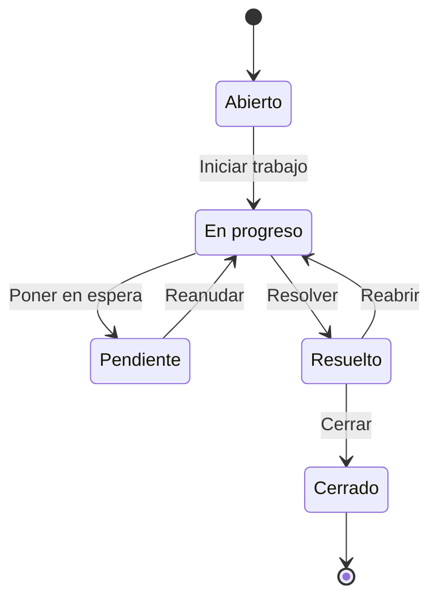

# Guía de uso

Esta guía explica cómo se usa la aplicación desde el punto de vista de cada
persona: qué ve, qué puede hacer y cómo avanza un incidente desde que alguien
lo abre hasta que se cierra.

Si todavía no la tienes en marcha, sigue los pasos del
[README principal](../README.md#pruébalo-en-tu-ordenador).

## Las tres personas que usan la aplicación

**El empleado** es quien tiene el problema. Puede abrir incidentes, ver los
suyos (y solo los suyos), añadir comentarios y chatear con los técnicos. En el
menú lateral ve *Crear incidente*, *Mis incidentes* y *Chat*.

**El técnico** es quien resuelve. Ve todos los incidentes, se los asigna,
cambia su estado, anota el diagnóstico y la solución, y puede chatear con
cualquiera. Su menú está organizado como una cola de trabajo: *Asignados a
mí*, *Sin asignar*, *Abiertos*, *En progreso*, *Pendientes*, *Resueltos* y
*Todos los incidentes*, además del *Dashboard*.

**El administrador** puede hacer todo lo que hace un técnico y, además,
gestionar usuarios, técnicos y catálogos (departamentos, categorías y
prioridades).

## Recorrido de cinco minutos

Abre dos ventanas: una normal y otra de incógnito. Cada una mantiene su
propia sesión, así que puedes ser dos personas a la vez.

1. **Entra como Empleado A** (`empleadoA@empresa.test`) y pulsa *Crear
   incidente* en el menú lateral. Escribe una breve descripción (por ejemplo,
   "No me funciona el Wi-Fi"), cuenta un poco más en la descripción y pulsa
   **Enviar**. Si el empleado tiene un equipo asignado, aparece ya elegido.
   El incidente recibe un número del tipo `INC0000005`.
2. **En la otra ventana, entra como Tecnico A** (`tecnicoA@empresa.test`) y
   abre *Sin asignar*. Ahí está el incidente recién creado. Ábrelo, elige
   "Tecnico A" en el campo **Asignado a** y pulsa **Iniciar trabajo**. Desde
   ese momento aparece en su cola *Asignados a mí*.
3. **Pulsa "Chatear con Empleado A".** Se abre el chat con el texto *"Sobre
   el ticket #5:"* ya escrito. Envía una pregunta: en la ventana del empleado
   aparece al instante, con un contador rojo en *Chat* y el aviso
   "escribiendo…" mientras el técnico teclea.
4. **Resuelve el incidente.** Vuelve a la ficha, abre la pestaña
   *Información de resolución*, escribe el diagnóstico y la solución y pulsa
   **Resolver**. En la pestaña *Notas* queda toda la historia: comentarios,
   cambios de estado y quién hizo cada cosa.
5. **Prueba el buscador de arriba.** Escribe `INC0000005` (o simplemente `5`)
   y te lleva directo al incidente. Si escribes una palabra, la busca en todos.
6. **Entra como Administrador** (`administrador@empresa.test`) y abre el
   *Dashboard*. Prueba también el modo oscuro con el botón de la luna.

## La vida de un incidente

Un incidente pasa por cinco estados. Cada paso se da con un botón en la
cabecera de su ficha, y la barra de flechas muestra en qué punto está.

- **Abierto:** alguien ha avisado del problema y está esperando a que lo
  atiendan.
- **En progreso:** un técnico está trabajando en él. Para llegar aquí el
  incidente tiene que tener un técnico asignado.
- **Pendiente:** el trabajo está parado a la espera de algo (una pieza, una
  respuesta del empleado…).
- **Resuelto:** el problema está arreglado. Para poder resolverlo hay que
  dejar escrito el diagnóstico y la solución, así la próxima vez que pase
  algo parecido habrá con qué consultar. La aplicación calcula sola cuánto
  tiempo ha tardado.
- **Cerrado:** ya no se puede tocar ni comentar. Si el problema vuelve
  mientras está *Resuelto*, se puede **reabrir**.

Los colores ayudan a ver de un vistazo qué necesita atención: 🔴 abierto,
🟡 en progreso o pendiente y 🟢 resuelto o cerrado. La prioridad va de
`1 - Crítica` a `4 - Baja`.

## Las listas de incidentes

Cada entrada del menú lateral es una lista ya filtrada. Dentro de cualquier
lista puedes:

- **Buscar** por texto en la descripción.
- **Abrir los filtros** para acotar por estado, prioridad, categoría, técnico,
  fechas o solo los que no tienen técnico. Encima de la tabla se ve en forma
  de ruta qué condiciones están activas (`Todos > Estado = Abierto`), y cada
  una tiene una × para quitarla.
- **Ordenar** pulsando en el título de una columna (número, prioridad, estado
  o fecha).
- **Abrir un incidente** pulsando en cualquier parte de su fila.

## El chat

El chat funciona como una aplicación de mensajería: muestra si un mensaje se
ha enviado, entregado o leído, si la otra persona está en línea y cuándo está
escribiendo. Si en un mensaje escribes `#12`, se convierte en un enlace al
incidente 12.

Para mantener la privacidad, una conversación solo la pueden leer sus dos
participantes; ni siquiera el administrador puede ver chats ajenos. Los
empleados solo pueden chatear con técnicos y administradores, no entre ellos.

## Quién puede hacer qué

| | Empleado | Técnico | Administrador |
|---|---|---|---|
| Incidentes | Crear; ver y comentar **solo los suyos** | Ver todos, asignar, cambiar estado y resolver | Igual que el técnico |
| Dashboard | — | ✅ | ✅ |
| Usuarios y técnicos | — | Ver | Gestionar |
| Departamentos, categorías y prioridades | Ver | Ver | Gestionar |
| Equipos | Ver | Gestionar | Gestionar |
| Chat | Con técnicos y administradores | Con cualquiera | Con cualquiera |

Si un empleado intenta abrir un incidente que no es suyo, la aplicación le
responde que no existe en lugar de decirle que no tiene permiso. Así no se
puede averiguar qué incidentes hay probando números.
